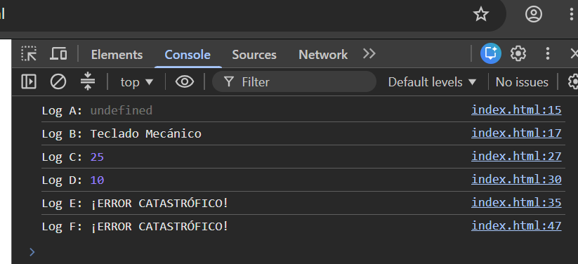

# Actividad 2.3 – Predicción de logs: hoisting y ámbito

## Tabla de predicciones

| Identificador | ¿Qué imprimirá la consola? (Predicción) | Justificación teórica |
|---|---|---|
| Log A | `Log A: undefined` | **Hoisting de `var`**: la declaración se eleva al inicio del ámbito y se inicializa a `undefined`; la asignación se queda en su línea, que aún no se ha ejecutado. |
| Log B | `Log B: Teclado Mecánico` | La asignación ya se ha ejecutado, así que `producto` tiene su valor. |
| Log C | `Log C: 25` | **Ámbito de bloque (`let`)**: dentro del `if` existe un `descuento` propio que tapa al de la función. |
| Log D | `Log D: 10` | Fuera del `if` el `descuento` de bloque ya no existe; se usa el `var` de **ámbito de función** (10). |
| Log E | `Log E: ¡ERROR CATASTRÓFICO!` | `impuesto` es `const` con **ámbito de bloque**: fuera del `if` no existe y lanza `ReferenceError: impuesto is not defined`, que captura el `catch`. |
| Log F | `Log F: ¡ERROR CATASTRÓFICO!` | **Zona Temporal de Muerte (TDZ)**: `let precio` se eleva pero no se puede leer antes de su declaración y lanza `ReferenceError: Cannot access 'precio' before initialization`. |

## Verificación

Ejecutado el código en la consola de las DevTools (Chrome), los seis resultados coinciden con la tabla de predicciones.

## Conclusión crítica

Con `let`/`const`el error es inmediato y predecible; con `var` los fallos aparecen tarde y son difíciles de depurar cuando trabajan muchas personas sobre el mismo código.