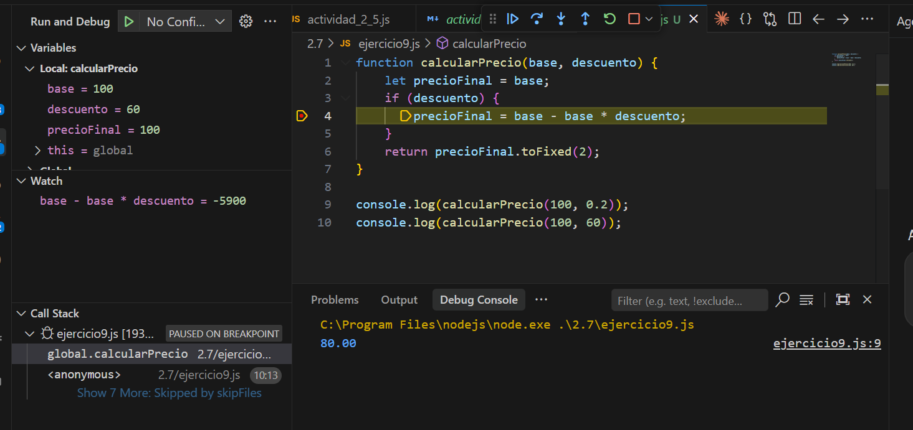

# Actividad 2.7 – Depuración: primeros pasos

## Ejercicio 1: Variable inexistente
- **Error:** el `console.log` usa `reslt`, pero la variable se llama `result`.
- **Tipo:** de ejecución (`ReferenceError: reslt is not defined`), por un error tipográfico en el nombre.
- **Corrección:** `console.log("Resultado es: " + result);` → muestra `Resultado es: 15`.

## Ejercicio 2: Comparaciones sospechosas
- **Error:** la condición `edad => 18` usa `=>` (sintaxis de función flecha) en vez del operador `>=`. JavaScript la interpreta como una función, que siempre es verdadera, y por eso siempre entra en la primera rama.
- **Tipo:** lógico (la sintaxis es válida, no da error).
- **Corrección:** `if (edad >= 18)` → con `edad = 16` muestra `Eres menor de edad`.

## Ejercicio 3: Return of the Jedi
- **Error:** el `return ofthejedi;` está comentado, así que la función calcula la multiplicación pero no devuelve nada (`undefined`) y `console.log` muestra `Total: undefined`.
- **Tipo:** lógico.
- **Corrección:** descomentar `return ofthejedi;` → muestra `Total: 12`.

## Ejercicio 4: Names, names...
- **Error:** la función recibe el parámetro `nombre`, pero dentro usa `name`, que no existe en ese ámbito.
- **Tipo:** de ejecución (`ReferenceError: name is not defined`), por un error de nombre.
- **Corrección:** `console.log("Hola " + nombre);` → muestra `Hola Ana`.

## Ejercicio 5: Out of control
- **Error:** el bucle usa `i <= numeros.length`; en la última vuelta `i` vale 4, `numeros[4]` es `undefined` y `suma += undefined` convierte `suma` en `NaN`.
- **Tipo:** lógico (error de límite, "off-by-one").
- **Corrección:** `for (let i = 0; i < numeros.length; i++)` → muestra `Suma total: 10`.

## Ejercicio 6: Usando expresiones
- **Error:** en el `if` se usa `=` (asignación) en vez de comparar: `num % 2 = 0`.
- **Tipo:** sintáctico (`SyntaxError: Invalid left-hand side in assignment`); el programa ni llega a ejecutarse.
- **Corrección:** `if (num % 2 === 0)` → `esPar(3)` da `false` y `esPar(4)` da `true`.

## Ejercicio 7: Callback defectuoso
- **Error:** `procesarDatos` recibe el parámetro `datos`, pero llama a `callback(dat)`, y `dat` no existe.
- **Tipo:** de ejecución (`ReferenceError: dat is not defined`), por un error de nombre.
- **Corrección:** `callback(datos);` → muestra `Datos recibidos: [ 1, 2, 3 ]`.

## Ejercicio 8: Evento click sospechoso
- **Error:** dentro del evento se declara `msg`, pero el `console.log` usa `msj`. La página carga bien y el fallo solo aparece al hacer clic en el botón.
- **Tipo:** de ejecución (`ReferenceError: msj is not defined`), por un error tipográfico.
- **Corrección:** `console.log(msg);` → al hacer clic muestra `Hola mundo`.

## Ejercicio 9: Cálculo misterioso
- **Error:** la función espera el descuento como fracción (`0.2` = 20 %), pero el segundo log lo pasa como porcentaje (`60`). Así calcula `100 - 100 * 60 = -5900` y devuelve `-5900.00`. El código no está mal escrito: el fallo es de interpretación de los datos.
- **Tipo:** lógico / error humano (mezcla de formatos del descuento).
- **Corrección:** si el descuento es mayor que 1, se interpreta como porcentaje y se divide entre 100:

```js
function calcularPrecio(base, descuento) {
    let precioFinal = base;
    if (descuento > 1) {
        descuento = descuento / 100;
    }
    if (descuento) {
        precioFinal = base - base * descuento;
    }
    return precioFinal.toFixed(2);
}
```

Con esto, `calcularPrecio(100, 0.2)` da `80.00` y `calcularPrecio(100, 60)` da `40.00`.

## Captura de depuración (Ejercicio 9)

Depuración en VS Code detenida en un breakpoint en la línea `precioFinal = base - base * descuento;`, con `descuento = 60` visible en el panel de variables.


